# VEILLIA, cahier des charges et architecture

## 1. Présentation du projet

VEILLIA est un agregateur d'articles de data science et d'intelligence artificielle.
Il fonctionne sur le principe de Google News applique a un seul theme : tout ce qui
touche a la donnee et a l'IA. La plateforme collecte les flux RSS de plus de cent
sources, classe les articles par grande famille, genere un resume en francais et
renvoie le visiteur vers le site d'origine. Aucun texte n'est recopie.

Trois principes guides toute la conception.

1. Rediriger et non republier. VEILLIA garde les metadonnees du flux, jamais le
   corps de l'article.
2. Simplifier. Trois applications Django, des vues DRF en viewsets, une base
   SQLite en developpement et PostgreSQL en production.

## 2. Besoins fonctionnels

| Identifiant | Besoin | Priorite |
| --- | --- | --- |
| BF01 | Collecter les articles des flux RSS d'une liste de sources | Haute |
| BF02 | Classer chaque article dans une ou plusieurs familles de sujets | Haute |
| BF03 | Generer un resume en francais pour chaque article | Haute |
| BF04 | Afficher le fil d'articles a la une et le fil du jour | Haute |
| BF05 | Filtrer par famille, source, auteur, mot cle et periode | Haute |
| BF06 | Rediriger vers la source en mesurant le clic | Haute |
| BF07 | Creer et gerer un profil utilisateur | Haute |
| BF08 | Se connecter avec GitHub et LinkedIn | Moyenne |
| BF09 | Suivre des familles, des sources et des mots cles | Moyenne |
| BF10 | Proposer des recommandations personnelles motivees | Moyenne |
| BF11 | Historique de lecture du membre | Moyenne |
| BF12 | Envoyer un resume quotidien sur Telegram et WhatsApp | Moyenne |
| BF13 | Etre reference par Google et Google News | Haute |
| BF14 | Piloter les sources et la collecte depuis l'administration | Haute |

## 3. Besoins non fonctionnels

| Identifiant | Exigence |
| --- | --- |
| BNF01 | Une page d'accueil doit s'afficher en moins de deux secondes |
| BNF02 | Les requetes de liste utilisent des index sur la date de publication |
| BNF03 | Une collecte qui echoue ne doit jamais interrompre les autres sources |
| BNF04 | Le code respecte les principes SOLID, chaque service a une seule raison de changer |
| BNF05 | Toute la documentation de conception est ecrite avec des diagrammes |
| BNF06 | Le code et les noms de tables sont en francais |
| BNF07 | Les secrets sont lus depuis le fichier .env et ne sont jamais code en dur |
| BNF08 | La plateforme reste utilisable meme si le service de resume par IA est indisponible |

## 4. Contraintes

- Pas de republication de contenu : chaque clic doit conduire a la source
- Maximum trois applications Django pour garder un projet lisible
- React et les composants JS modernes restent du cote du front
- L'agent de diffusion externe est realise avec n8n, pas dans Django

## 5. Architecture generale

L'application suit une architecture en trois couches a l'interieur de chaque
application Django : les vues DRF apparaissent au dessus, les services portent
la logique metier, et les modeles stockent les donnees. Le front React consomme
l'api et n'appelle jamais la base directement.

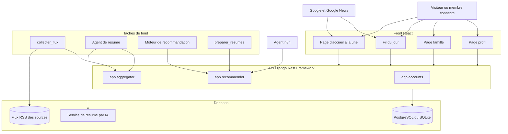

## 6. Diagramme de cas d'utilisation

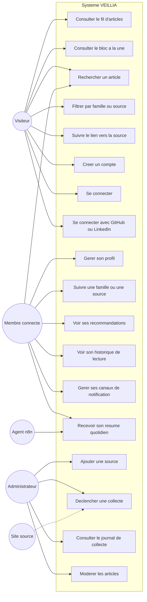

## 7. Diagramme de classes

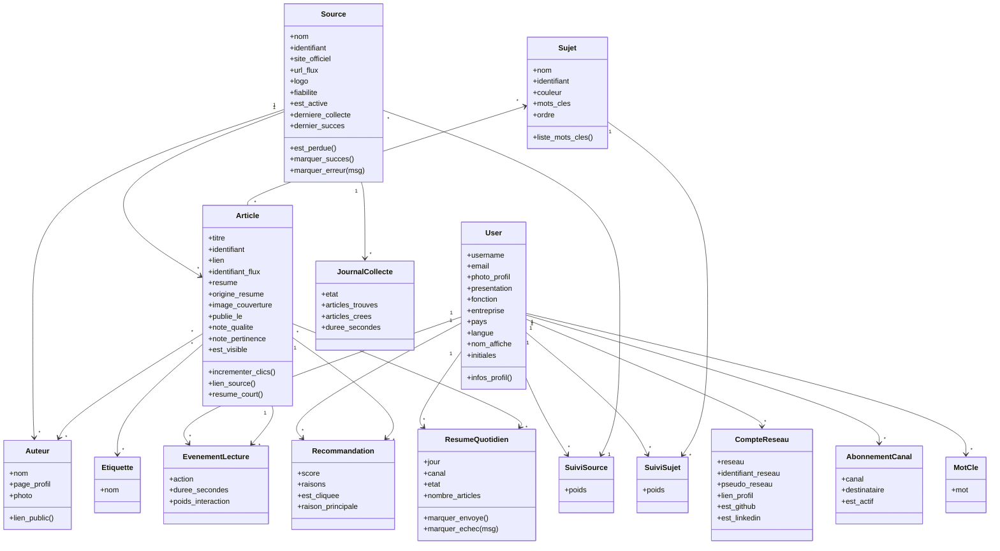

## 8. Diagramme entites associations

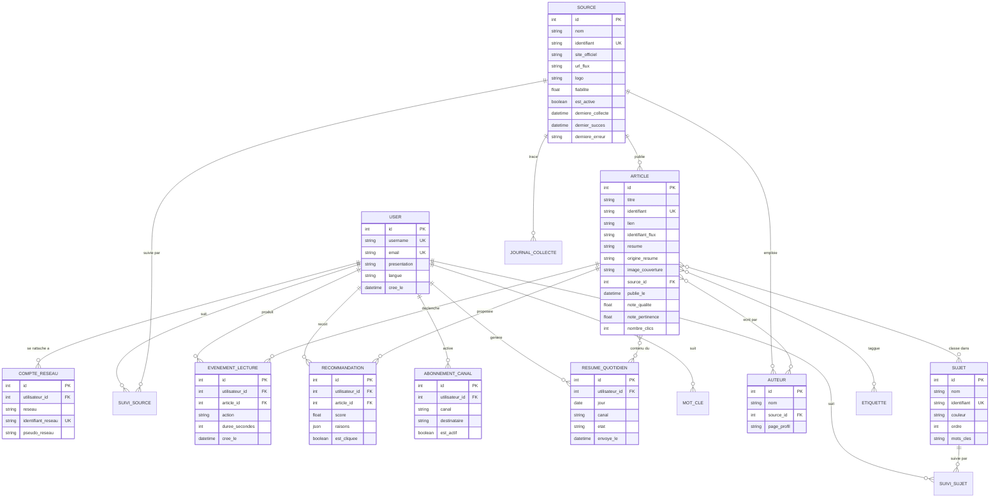

## 9. Diagramme d'activite de la collecte

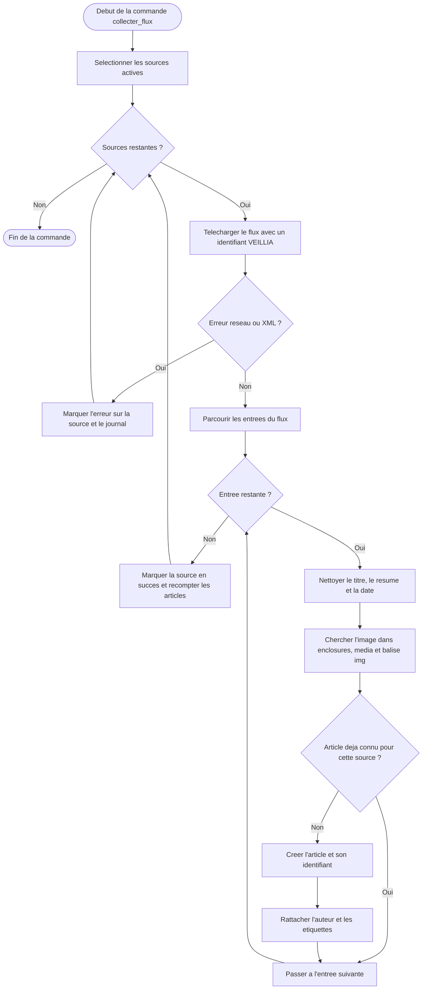

## 10. Machine a etats d'une source

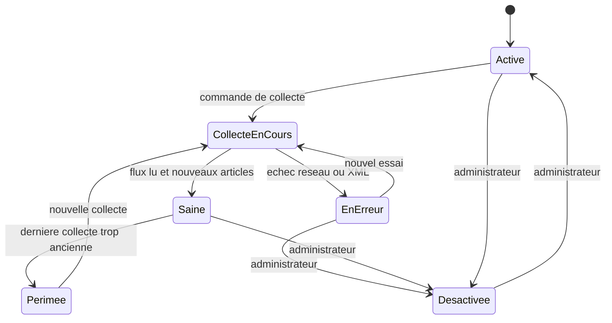

## 11. Diagrammes de sequence

### 11.1 Collecte d'un flux et enrichissement

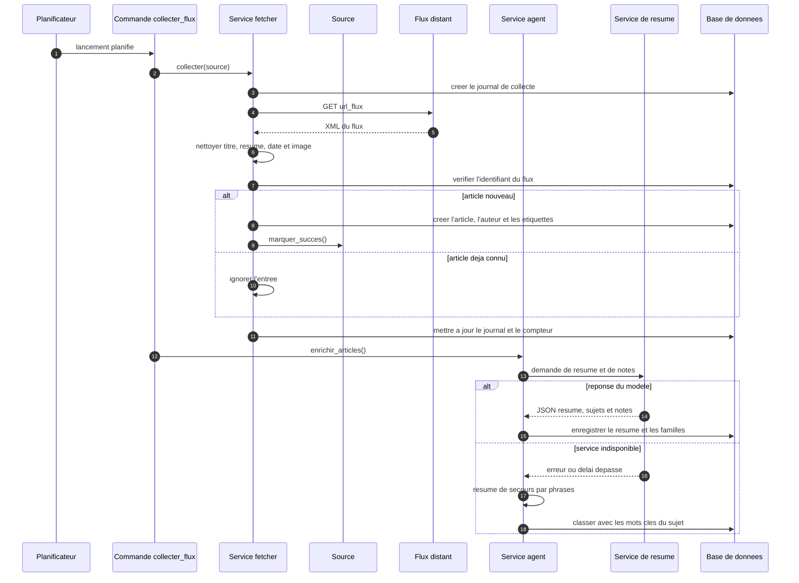

### 11.2 Inscription et connexion avec un reseau social

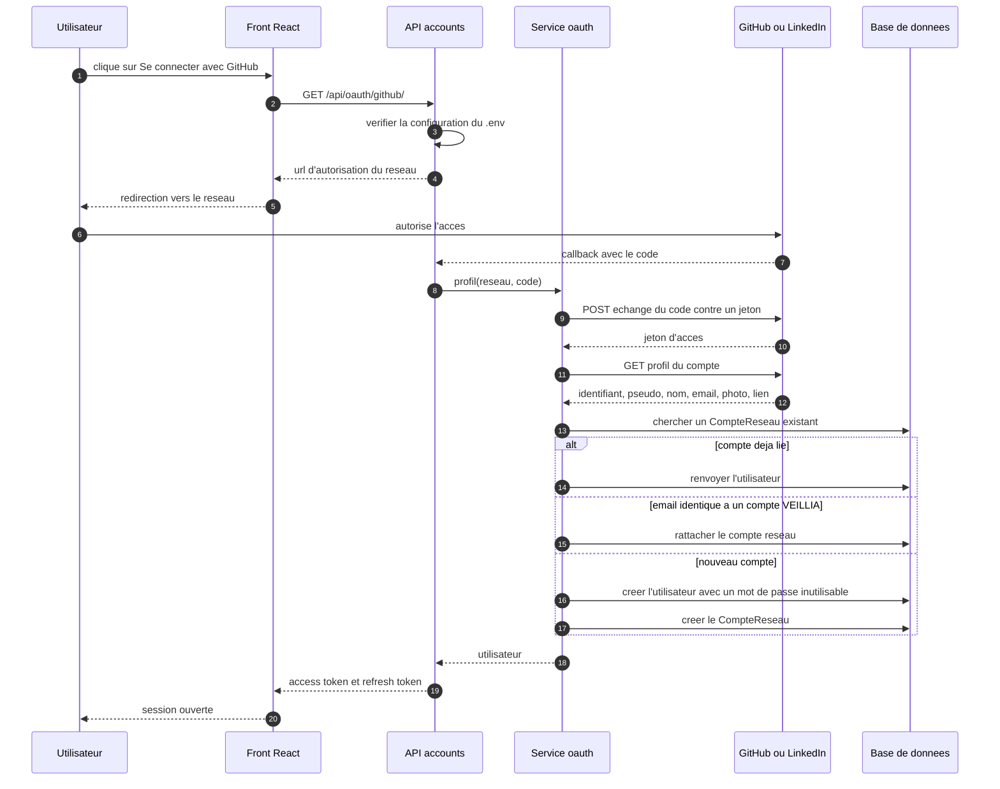

### 11.3 Calcul des recommandations

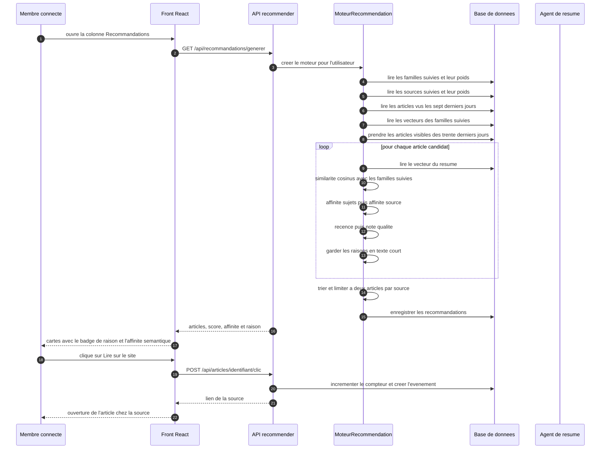

### 11.4 Diffusion quotidienne par l'agent n8n

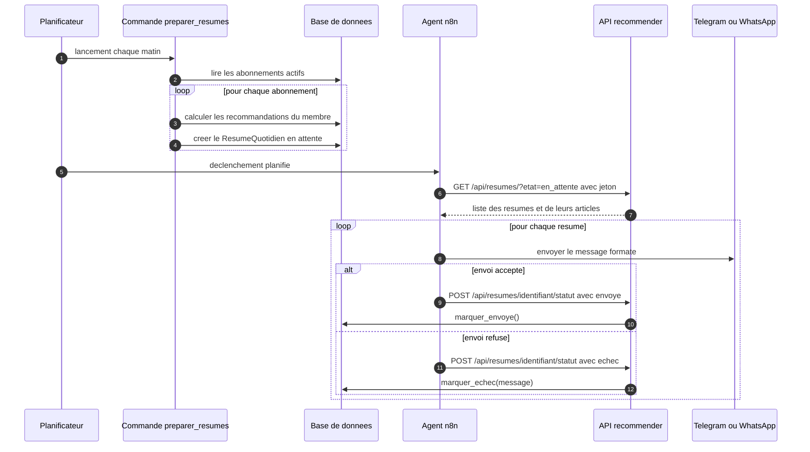

### 11.5 Redirection vers la source

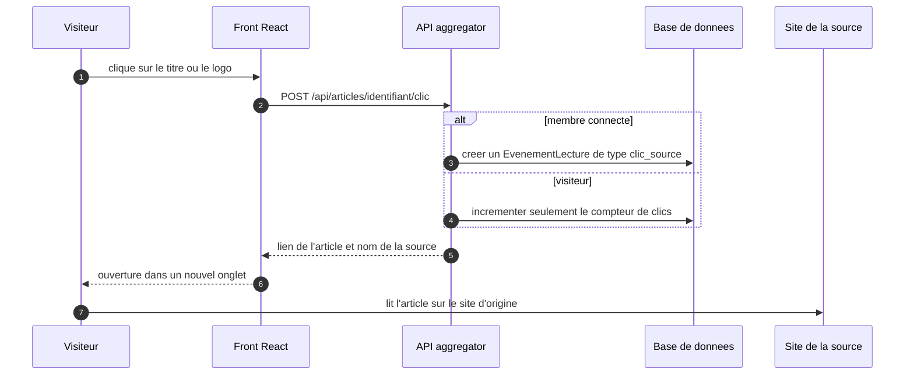

## 12. Diagramme de composants

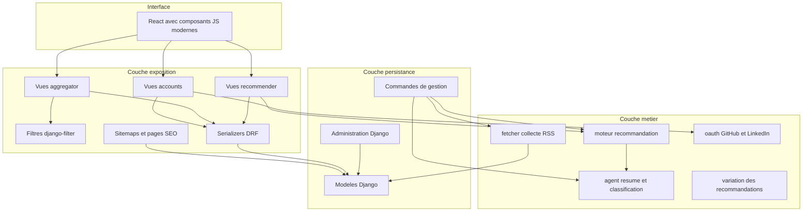

## 13. Diagramme de deploiement

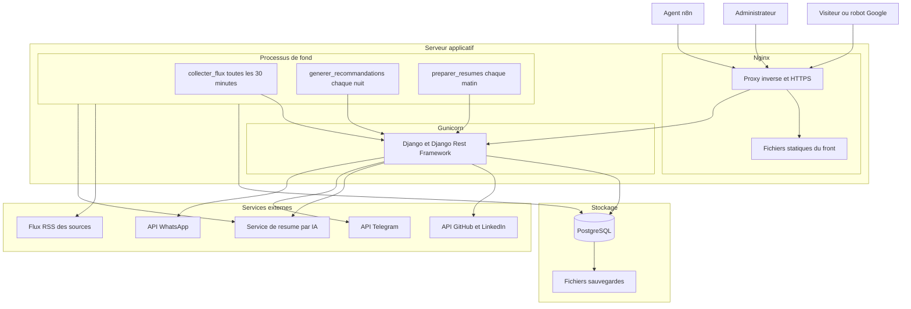

## 14. Repartition des responsabilites par application

| Application | Regle de responsabilite |
| --- | --- |
| `accounts` | Elle sait qui est la personne et comment elle se connecte. Elle ne connait pas les articles. |
| `aggregator` | Elle sait ce qui est publie, ou et quand. Elle ne connait pas les preferences des membres. |
| `recommender` | Elle sait ce que veut la personne. Elle ne cree aucun contenu et ne collecte aucun flux. |

Cette separation evite les imports croises inutiles et respecte le principe de
responsabilite unique.

## 15. Principes de conception appliques

| Principe | Application dans le projet |
| --- | --- |
| Responsabilite unique | Un service par metier : `fetcher`, `agent`, `moteur`, `oauth` |
| Ouvert ferme | Ajouter une source se fait depuis l'administration, sans toucher au code |
| Substitution | Le moteur accepte n'importe quelle liste d'articles candidats |
| Interface segregation | Un serializer leger pour le fil et un serializer complet pour le detail |
| Dependance faible | Les vues importent les services, jamais l'inverse |
| DRY | Les filtres, la pagination et la pagination de page sont definis une fois |

## 16. Referencement

Le referencement est treats comme une fonctionnalite, pas comme une option.

| Element | Mise en oeuvre |
| --- | --- |
| Donnees structurees | Un bloc JSON-LD `NewsArticle` dans chaque reponse d'article |
| Sitemap general | `sitemap.xml` avec les familles, les sources et mille articles |
| Sitemap news | `sitemap-news.xml` limite aux articles des deux derniers jours |
| Robots | `robots.txt` autorise le contenu public et bloque l'administration |
| Page sans JavaScript | `/html-simple` liste les derniers titres en HTML brut |
| Pages de profil | `/membre/pseudo/` renvoie une page HTML lisible |
| Flux Atom | `/flux/` pour les lecteurs RSS tiers |
| Titres stables | Chaque article et chaque sujet a un identifiant lisible dans son URL |
| Redirection unique | Le clic passe par l'api, la source est toujours le site d'origine |

## 17. Securite

| Risque | Reponse |
| --- | --- |
| Fuite de la cle secrete | Tout est lu dans le fichier `.env`, rien n'est ecrit en dur |
| Vol de jeton | Les jetons JWT expirent en soixante minutes et se renouvellent |
| Mot de passe faible | Validateurs Django, longueur minimale, hachage automatique |
| Fuite de donnees personnelles | Les vues du profil public ne renvoient pas l'email |
| Abus de l'api de clic | Le compteur est mis a jour en une requete, sans lecture du corps |
| Injection SQL | Tout passe par l'ORM, aucune requete concatenee |
| Depassement de flux | Chaque appel reseau a un delai maximal et un message d'erreur journalise |