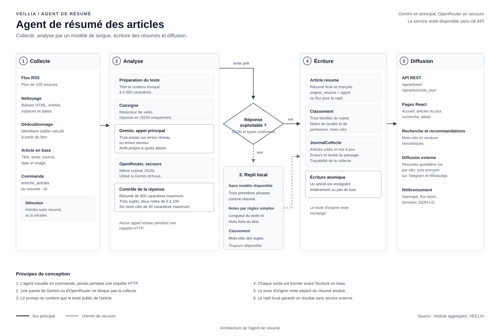

# Agent de résumé des articles

Ce document décrit la chaîne qui transforme un article brut collecté sur un flux
RSS en une fiche complète : un résumé en français, des notes de qualité et de
pertinence, des mots-clés et un classement dans les familles de sujets.

L'agent ne fonctionne pas pendant une requête HTTP. Il travaille en tâche de
fond, lancé par une commande Django. L'interface lit ensuite les champs déjà
enregistrés en base.



## 1. Rôle exact dans la plateforme

| Entrée | Traitement | Sortie |
| --- | --- | --- |
| Titre et texte d'un article | analyse par un modèle de langue | résumé de deux phrases |
| Texte, source, date | règles de secours si le modèle est absent | notes de 0 à 100 |
| Titre, résumé, familles existantes | classement par mots-clés | trois familles au maximum |
| Résultat de l'analyse | écriture contrôlée en base | article prêt pour le fil |

L'agent ne réécrit jamais l'article d'origine et ne republie pas son contenu. Il
produit un résumé court qui renvoie vers la source. Le texte complet n'est pas
stocké : le champ `resume` contient le résumé produit, et `origine_resume`
indique sa provenance (`agent` ou `flux`).

## 2. Les quatre fichiers concernés

| Fichier | Responsabilité |
| --- | --- |
| `aggregator/services/fetcher.py` | lit le flux, nettoie le HTML, extrait l'image et la date |
| `aggregator/services/agent.py` | prépare le prompt, appelle le modèle, valide la réponse, applique le repli |
| `aggregator/llm.py` | gère les appels HTTP vers Gemini puis OpenRouter, les essais et les quotas |
| `aggregator/management/commands/enrichir_articles.py` | sélectionne les articles à traiter et enregistre le résultat |

La commande `resume.py` sert aux essais sur un seul article. Elle utilise le même
module `llm.py`, ce qui évite de dupliquer la logique réseau.

## 3. Workflow complet, étape par étape

### 3.1 Collecte du flux

La commande `collecter_flux` parcourt les sources actives. Pour chaque flux, le
module `fetcher.py` :

1. télécharge le document XML avec un délai maximal ;
2. lit les entrées RSS ou Atom ;
3. nettoie le HTML du titre et du résumé ;
4. extrait l'image de couverture quand elle existe ;
5. convertit la date de publication en date locale ;
6. calcule un identifiant stable à partir du lien ;
7. ignore l'entrée si le même identifiant existe déjà.

Un article est enregistré avec `est_visible=True` seulement si le titre et le
lien sont exploitables. Les erreurs de collecte sont écrites dans
`JournalCollecte` avec le nom de la source et le message d'erreur.

### 3.2 Sélection des articles à résumer

Deux commandes existent, avec des usages différents.

`enrichir_articles` prend les articles visibles qui n'ont pas encore de résumé
ou qui n'ont pas encore de familles. Elle traite cinquante articles par défaut.
L'option `--reprendre` permet de retraiter des articles déjà remplis.

`resume` sert au diagnostic. Elle accepte un identifiant précis, un nombre
maximal d'articles, un mode essai sans écriture et une pause entre deux appels.

```bash
uv run python manage.py enrichir_articles --nombre 50
uv run python manage.py enrichir_articles --reprendre
uv run python manage.py resume --id 128 --dry-run
uv run python manage.py resume --max 20 --pause 8
```

La sélection exclut les articles sans texte. Un article dont le texte fait moins
de 200 caractères est recopié tel quel : il n'y a pas assez de matière pour
justifier un appel de modèle.

### 3.3 Préparation du texte

Le texte envoyé au modèle est construit en trois parties :

1. la consigne fixe, qui définit le rôle et le format de sortie ;
2. le titre de l'article ;
3. le texte nettoyé, tronqué à 4 000 caractères.

La troncature est volontaire. Un article de 20 000 caractères coûte cher et
n'apporte pas plus de précision au-delà des premiers paragraphes. Le texte est
nettoyé avant l'envoi : balises HTML supprimées, entités décodées, espaces
normalisés.

### 3.4 Appel du modèle principal

Le modèle principal est Gemini. Le module `llm.py` envoie une requête HTTP avec
la clé lue dans `GEMINI_API_KEY`. Trois essais sont prévus :

| Situation | Comportement |
| --- | --- |
| erreur réseau | attente de 2 puis 4 secondes, nouvel essai |
| réponse 429, quota atteint | attente de 10 puis 20 secondes, puis arrêt propre |
| réponse 500 ou plus | attente de 3 puis 6 secondes, nouvel essai |
| clé refusée, 401 ou 403 | arrêt immédiat, message clair dans la console |
| réponse 400 | erreur remontée, aucun nouvel essai |

Le niveau de raisonnement est réglé à `minimal`. Le résumé ne demande pas de
raisonnement complexe, et ce réglage économise le quota gratuit.

### 3.5 Secours OpenRouter

Si Gemini échoue pour une raison réseau ou si le quota est épuisé, le module
`llm.py` tente OpenRouter avec le même contrat JSON. La clé et le modèle sont
lus dans `OPENROUTER_API_KEY` et `OPENROUTER_MODEL`.

Ce second fournisseur n'est pas un doublon : il permet de finir une collecte
lorsque le quota Gemini du jour est atteint. Le code ne bascule pas
automatiquement sur OpenRouter pour une erreur de clé Gemini, car le problème
serait identique et l'appel échouerait aussi.

### 3.6 Contrôle de la réponse

Le modèle doit renvoyer un objet JSON avec cinq clés. Le code ne fait pas
confiance au texte brut : il convertit la réponse avec `json.loads`, puis borne
chaque valeur.

| Champ | Contrôle appliqué |
| --- | --- |
| `resume` | converti en texte, 900 caractères maximum |
| `sujets` | trois identifiants maximum |
| `note_qualite` | converti en nombre, utilisé entre 0 et 100 |
| `note_pertinence` | converti en nombre, utilisé entre 0 et 100 |
| `mots_cles` | six éléments maximum, 40 caractères par élément |

Si la réponse n'est pas du JSON valide, si une clé manque ou si un type est
inattendu, l'exception est interceptée et le repli local prend le relais. Le
message d'erreur est écrit dans le journal, jamais affiché au visiteur.

### 3.7 Repli local

Le repli local garantit que la plateforme reste utilisable sans clé API, sans
réseau ou avec un quota épuisé. Il est volontairement simple.

| Fonction | Méthode |
| --- | --- |
| `resume_simple` | garde les trois premières phrases, coupe à 600 caractères |
| `noter_simple` | note la qualité selon la longueur, la pertinence selon les mots forts |
| `classer_par_mots_cles` | cherche les mots-clés des familles dans le titre et le résumé |

Le classement par mots-clés utilise une recherche avec limites de mot. Cela
évite de confondre `ml` avec `html`. Trois familles au maximum sont retenues.

### 3.8 Persistance

Une fois l'analyse validée, la commande écrit les champs dans l'article :

- `resume` : le texte final ;
- `origine_resume` : `agent` si le modèle a répondu, `flux` pour le repli ;
- `note_qualite` et `note_pertinence` ;
- `sujets` : les familles trouvées, via la relation plusieurs à plusieurs.

L'écriture est faite article par article. Si une écriture échoue, les autres
articles ne sont pas perdus. Le compteur final affiche le nombre de résumés
réussis et le nombre d'erreurs.

### 3.9 Journal et supervision

`JournalCollecte` garde la trace de chaque passage : source, date, nombre
d'articles trouvés, nombre d'articles créés, message d'erreur éventuel. La
commande affiche aussi une ligne par article traité.

Pour suivre la qualité du traitement, on regarde trois chiffres :

| Indicateur | Requête |
| --- | --- |
| articles sans résumé | `Article.objects.filter(resume="").count()` |
| articles traités par le modèle | `Article.objects.filter(origine_resume="agent").count()` |
| articles traités par le repli | `Article.objects.filter(origine_resume="flux").count()` |

## 4. Contrat JSON demandé au modèle

```json
{
  "resume": "Deux phrases en français qui expliquent l'apport de l'article.",
  "sujets": ["ia-generative", "mlops"],
  "note_qualite": 78,
  "note_pertinence": 85,
  "mots_cles": ["rag", "vectorisation", "pgvector"]
}
```

Le prompt complet envoyé au modèle est le suivant :

```text
Tu es un rédacteur de veille technologique. Tu analyses des articles de data
science et d'intelligence artificielle. Réponds uniquement avec un objet JSON.

Titre : <titre de l'article>

Texte : <texte tronqué à 4 000 caractères>

Rends un JSON avec les clés suivantes :
{"resume": "2 phrases en français", "sujets": ["ml", "dl"],
 "note_qualite": 0-100, "note_pertinence": 0-100,
 "mots_cles": ["3 à 6 mots clés"]}
```

La consigne est courte pour trois raisons : elle coûte moins de tokens, elle est
plus stable d'un appel à l'autre et elle laisse moins de place à une réponse
hors format.

## 5. Gestion des erreurs

| Erreur | Effet sur le traitement | Ce que voit l'opérateur |
| --- | --- | --- |
| clé absente | repli local immédiat | message d'information au démarrage |
| quota atteint | arrêt de la boucle, les articles suivants sont gardés pour plus tard | message « limite atteinte » |
| panne réseau | trois essais puis repli | avertissement dans la console |
| JSON invalide | repli local pour cet article | avertissement avec le titre tronqué |
| texte trop court | recopie du texte, aucun appel | avertissement explicite |
| erreur d'écriture | article suivant | erreur signalée, compteur d'échecs |

Trois erreurs consécutives dans la commande `resume` arrêtent la boucle. C'est
un garde-fou : si le service est tombé, il est inutile de consommer du temps sur
les centaines d'articles restants.

## 6. Configuration

Les variables utiles sont dans `.env` :

```bash
GEMINI_API_KEY=...
GEMINI_MODEL=gemini-3.5-flash
GEMINI_THINKING_LEVEL=minimal
GEMINI_PAUSE=6
LANGUE_RESUME=fr

OPENROUTER_API_KEY=...
OPENROUTER_API_URL=https://openrouter.ai/api/v1/chat/completions
OPENROUTER_MODEL=google/gemini-3.5-flash-lite
```

`GEMINI_PAUSE` est le nombre de secondes entre deux appels. Il évite de dépasser
la limite par minute du plan gratuit. La valeur conseillée est de six secondes.

## 7. Vérifications

### 7.1 Vérifier la configuration sans appel réseau

```bash
uv run python manage.py shell -c "from aggregator.services.agent import AgentResume; print(AgentResume().est_configure)"
```

La commande affiche `True` si une clé est disponible, `False` sinon.

### 7.2 Tester un article en mode essai

```bash
uv run python manage.py resume --id 128 --dry-run
```

Le résumé s'affiche dans la console et rien n'est enregistré. C'est le test à
faire avant une campagne sur plusieurs centaines d'articles.

### 7.3 Vérifier le repli

Couper temporairement la clé dans `.env`, puis lancer :

```bash
uv run python manage.py enrichir_articles --nombre 2
```

Les articles doivent recevoir un résumé composé des premières phrases et
`origine_resume` doit valoir `flux`. Remettre la clé ensuite.

### 7.4 Vérifier la cohérence en base

```bash
uv run python manage.py shell -c "from aggregator.models import Article; print(Article.objects.filter(resume='').count()); print(Article.objects.filter(origine_resume='agent').count())"
```

### 7.5 Lancer les tests du module

```bash
uv run python manage.py test aggregator
```

Les tests couvrent la création d'article, l'identifiant unique, le résumé court,
le nettoyage HTML, l'extraction d'image, la date par défaut, les filtres de
l'API et le compteur de clics.

## 8. Limites connues

- Le modèle peut produire un résumé factuellement imprécis. La source reste
  accessible sur chaque carte, et le résumé est présenté comme une aide.
- Un article très court n'est pas résumé par le modèle : il est recopié.
- Le classement automatique peut laisser un article sans famille si aucun mot-clé
  ne correspond. La commande `classer_articles` permet de repasser ensuite.
- Le quota gratuit impose une cadence lente. Une collecte de plusieurs milliers
  d'articles se fait en plusieurs passages.
- Le texte envoyé au modèle est public. Aucune donnée de membre n'entre dans le
  prompt.

## 9. Résumé du flux

```text
Flux RSS
  -> nettoyage et dédoublonnage
  -> article en base sans résumé
  -> AgentResume.analyser
       -> Gemini, puis OpenRouter
       -> réponse JSON contrôlée
       -> repli local si nécessaire
  -> écriture du résumé, des notes et des familles
  -> API et pages React
  -> vecteurs sémantiques pour les recommandations
```
