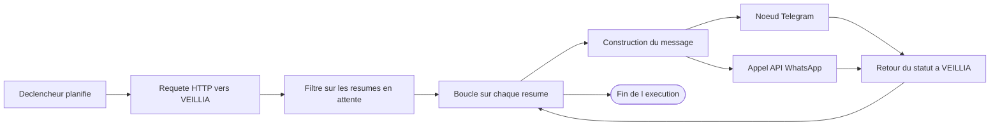
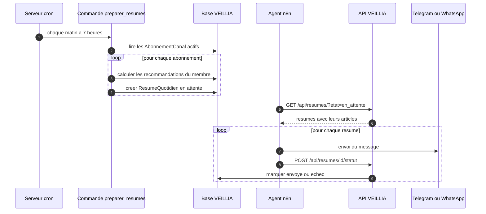

# Agent n8n pour VEILLIA, diffusion WhatsApp et Telegram

Ce document décrit l'agent de diffusion construit avec n8n. Il lit les resumes
quotidiens prepares par Django, envoie un message par membre sur chaque canal
abonne, puis informe VEILLIA du resultat. Un second workflow repond aux
demandes de recommandation instantanee envoyees depuis Telegram.

## 1. Pourquoi n8n

Telegram et WhatsApp ne sont pas des canaux que le back doit gerer. Un
planificateur, des retries, des journaux et plusieurs providers de messagerie
sont déjà résolus par n8n. Django prepare les donnees, n8n envoie. Le couplage
se limite a trois appels d'api, ce qui respecte le principe de responsabilite
unique.

| Responsabilite | Outil |
| --- | --- |
| Calculer les recommandations | Django |
| Choisir les articles du jour | Django |
| Planifier l'envoi | n8n |
| Envoyer le message | n8n |
| Gerer les erreurs de transport | n8n |
| Enregistrer le resultat de l'envoi | Django |

## 2. Vue d'ensemble



## 3. Preparation cote Django



Commandes a installer dans la crontab du serveur :

```bash
*/30 * * * * cd /srv/veillia && uv run python manage.py collecter_flux >> /var/log/veillia-collecte.log 2>&1
15 6 * * * cd /srv/veillia && uv run python manage.py generer_recommandations --nombre 20 >> /var/log/veillia-reco.log 2>&1
0 7 * * * cd /srv/veillia && uv run python manage.py preparer_resumes >> /var/log/veillia-resume.log 2>&1
```

## 4. Jeton de service

n8n s'authentifie avec un jeton porte par un compte technique, pas par un membre.

```bash
uv run python manage.py jeton_service --utilisateur robot
```

Le jeton affiche est a copier dans le credential HTTP de n8n :

| Champ | Valeur |
| --- | --- |
| URL de base | `https://api.veillia.com` |
| Header | `Authorization: Bearer <jeton>` |
| Compte technique | `robot`, jamais un compte reel |

Pour revoquer l'acces :

```bash
uv run python manage.py jeton_service --utilisateur robot --revoquer
```

## 5. Workflow 1, resume quotidien sur Telegram

Fichiers a importer dans n8n, menu `Workflows` puis `Import from File` :

| Fichier | Usage |
| --- | --- |
| `docs/n8n/veillia-resume-telegram.json` | resume quotidien Telegram |
| `docs/n8n/veillia-resume-whatsapp.json` | resume quotidien WhatsApp |
| `docs/n8n/veillia-reco-instantanee-telegram.json` | recommandation instantanee sur commande |

Avant d'activer un workflow, definir les variables d'environnement suivantes
dans les credentials de l'instance n8n :

| Variable | Contenu |
| --- | --- |
| `VEILLIA_URL` | `https://api.veillia.com` |
| `VEILLIA_JETON` | jeton donne par la commande `jeton_service` |
| `WHATSAPP_NUMERO_ID` | identifiant du numero professionnel WhatsApp |
| `WHATSAPP_JETON` | jeton temporaire de l'API Cloud de Meta |

### Etapes du workflow Telegram

| Etape | Noeud n8n | Role |
| --- | --- | --- |
| 1 | Schedule Trigger | tous les jours a 7 heures |
| 2 | HTTP Request | `GET /api/resumes/?etat=en_attente` avec le jeton |
| 3 | Code | transforme la reponse en liste de messages Telegram |
| 4 | Split In Batches | traite les membres par lots de cinq |
| 5 | Telegram | `sendMessage` en mode HTML |
| 6 | Wait | attend trois secondes entre deux envois |
| 7 | HTTP Request | `POST /api/resumes/id/statut/` avec `envoye` ou `echec` |

Texte du message envoye au membre :

```text
Bonjour {prenom}, voici votre veille data et IA du {date}.

1. {titre}
   {resume court}
   Source : {nom de la source}

2. {titre}
   ...

Recommendation complete : https://veillia.com/pour-vous
```

## 6. Workflow 2, resume quotidien sur WhatsApp

Fichier a importer : `docs/n8n/veillia-resume-whatsapp.json`

WhatsApp passe par l'API officielle WhatsApp Cloud. On utilise un noeud HTTP
Request qui appelle le point d'entree de messages.

| Champ | Valeur |
| --- | --- |
| Methode | `POST` |
| URL | `https://graph.facebook.com/v20.0/{numero_id}/messages` |
| Header | `Authorization: Bearer {jeton_meta}` |
| Corps | JSON avec `messaging_product`, `to`, `type` et `text` |

```json
{
  "messaging_product": "whatsapp",
  "recipient_type": "individual",
  "to": "{{ $json.destinataire }}",
  "type": "text",
  "text": {
    "preview_url": true,
    "body": "{{ $json.texte }}"
  }
}
```

La valeur `destinataire` vient du champ `AbonnementCanal.destinataire`, qui doit
contenir le numero au format international sans signe plus, par exemple
`221770000000`. Pour une chaine WhatsApp, le numero doit avoir accepte la
conversation dans les vingt-quatre heures qui precedent, sinon l'API renvoie
une erreur a traiter par une file d'attente.

## 7. Workflow 3, recommandation instantanee

Fichier a importer : `docs/n8n/veillia-reco-instantanee-telegram.json`

Le membre ecrit `/reco` dans le chat Telegram. n8n appelle le point d'entree
`GET /api/recommandations/instantanees/?destinataire=<id du chat>&nombre=3`,
qui retrouve le membre grace a son abonnement de canal, calcule ses
recommandations et renvoie les articles avec la raison de la proposition.

| Etape | Noeud n8n | Role |
| --- | --- | --- |
| 1 | Telegram Trigger | message recu |
| 2 | IF | garde seulement les messages commencant par `/reco` |
| 3 | HTTP Request | appelle l'api des recommandations instantanees |
| 4 | Code | met en forme la reponse en texte court |
| 5 | Telegram | repond dans le meme chat |

Le message recu par le membre :

```text
Voici vos recommandations du moment :

1. Comment Postgres vectorise vos documents (Parce que vous suivez MLOps)
   Postgres 18 introduit le stockage vectoriel natif, ce qui evite...
   https://source.com/article
```

Pour relier un chat Telegram a un compte VEILLIA, on utilise la commande de
gestion suivante, une fois par membre :

```bash
uv run python manage.py shell -c "from django.contrib.auth import get_user_model; from recommender.models import AbonnementCanal; u = get_user_model().objects.get(username='demo'); AbonnementCanal.objects.update_or_create(utilisateur=u, canal='telegram', destinataire='123456789')"
```

## 8. Securite de l'agent

| Regle | Mise en oeuvre |
| --- | --- |
| Compte technique | Utilisateur `robot`, jamais le compte d'un membre |
| Revocation immediate | Commande `jeton_service --revoquer` |
| Secrets dans n8n | Credentials de l'instance, jamais dans les noeuds en clair |
| HTTPS obligatoire | Les urls de l'api commencent par `https` |
| Limite de debit | Split In Batches avec une attente entre deux lots |
| Journalisation | Chaque execution est conservee dans n8n pendant quatorze jours |
| Filtrage des destinataires | On ne lit que les lignes `AbonnementCanal.est_actif` a vrai |

## 9. Gestion des erreurs dans n8n

| Erreur | Reglage |
| --- | --- |
| Telegram renvoie 429 | Attendre trente secondes et reessayer une fois |
| WhatsApp renvoie 131026 | Numero non joignable, marquer le resume en echec |
| WhatsApp renvoie 131047 | Fenetre de vingt-quatre heures fermee, mettre en file d'attente |
| L'api VEILLIA renvoie 401 | Jeton expire, regenerer avec `jeton_service` |
| L'api VEILLIA renvoie 500 | Relancer l'execution complete, la logique est idempotente |

Dans tous les cas, l'agent appelle `POST /api/resumes/id/statut/` avec la valeur
`echec` et le message d'erreur, ce qui laisse une trace consultable dans
l'administration Django.

## 10. Test avant la mise en production

1. Creer un canal de test avec un membre de l'equipe
2. Lancer manuellement le workflow depuis n8n
3. Verifier que le membre recoit le message et que le statut passe a `envoye`
4. Simuler une panne en desactivant le canal du membre
5. Verifier que le statut passe a `echec` avec le motif du Telegram
6. Passer l'execution en mode actif et conserver un declenchement manuel en secours

## 11. Ressources

| Sujet | Adresse |
| --- | --- |
| Documentation n8n | https://docs.n8n.io/ |
| Noeud Telegram | https://docs.n8n.io/integrations/builtin/credentials/telegram/ |
| Noeud HTTP Request | https://docs.n8n.io/integrations/builtin/core-nodes/n8n-nodes-base.httprequest/ |
| API WhatsApp Cloud | https://developers.facebook.com/docs/whatsapp/cloud-api |
| API Telegram | https://core.telegram.org/bots/api |
| Bonnes pratiques n8n | https://docs.n8n.io/hosting/scaling/queue-mode/ |