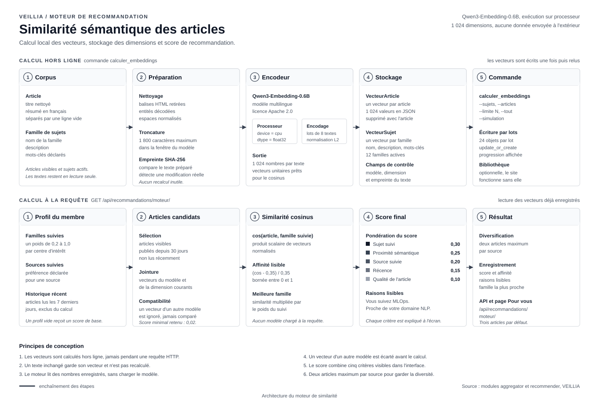

# Moteur de similarité sémantique

Ce document décrit la brique qui compare le contenu d'un article aux centres
d'intérêt d'un membre. Elle explique le modèle retenu, le calcul des vecteurs,
la formule du score, les tables ajoutées, les commandes d'exploitation et les
points de vigilance.

Le moteur fonctionne en deux temps. Un calcul hors ligne transforme les textes
en vecteurs et les enregistre. Un calcul en ligne compare ces vecteurs au profil
du membre, sans jamais charger le modèle pendant une requête HTTP.



## 1. Pourquoi un modèle d'embedding

Une famille comme « MLOps » et un article qui parle de « déploiement continu
d'un modèle » ne partagent pas forcément les mêmes mots. Une recherche par
mots-clés rate ces rapprochements. Un modèle d'embedding transforme chaque
texte en une liste de nombres : deux textes qui parlent du même sujet ont des
vecteurs proches, même s'ils emploient un vocabulaire différent.

Le projet utilise ce signal comme un des cinq critères de recommandation. Il ne
remplace pas les familles suivies : il complète le classement quand un article
n'est pas encore rangé dans une famille, ou quand il touche au sujet sans en
reprendre les termes exacts.

## 2. Le modèle retenu

| Caractéristique | Valeur |
| --- | --- |
| Modèle | `Qwen/Qwen3-Embedding-0.6B` |
| Licence | Apache 2.0 |
| Dimension | 1 024 nombres par texte |
| Exécution | processeur local, `device="cpu"` |
| Précision | `float32` |
| Bibliothèque | `sentence-transformers` |
| Groupe de dépendances | `embeddings`, installé par `uv sync --group embeddings` |

Le modèle est chargé une seule fois par processus, avec un verrou pour éviter
deux chargements simultanés. Il reste en mémoire pendant toute la durée de la
commande de calcul.

Le choix du processeur est assumé : le calcul est plus lent qu'avec une carte
graphique, mais il ne demande aucune machine spéciale, aucun compte externe et
aucun envoi de texte. Pour un corpus de quelques milliers d'articles, le calcul
complet tient en une seule exécution.

## 3. Les fichiers concernés

| Fichier | Rôle |
| --- | --- |
| `recommender/services/embeddings.py` | nettoie les textes, charge le modèle, calcule et compare les vecteurs |
| `recommender/services/moteur.py` | utilise la similarité dans le score de recommandation |
| `recommender/models.py` | stocke les vecteurs, les recommandations et le profil de suivi |
| `recommender/management/commands/calculer_embeddings.py` | précalcule les vecteurs par lots |
| `recommender/views.py` | expose l'état du moteur et les recommandations |

L'interface lit le résultat par `GET /api/recommandations/moteur/` et affiche
l'affinité sur chaque carte de la page « Pour vous ».

## 4. Workflow hors ligne : calcul des vecteurs

### 4.1 Sélection des textes

Deux types de textes sont vectorisés.

**Les articles.** Le texte est composé du titre nettoyé puis du résumé, séparés
par une ligne vide. Le titre porte le sujet principal, le résumé apporte le
contexte. Le tout est tronqué à 1 800 caractères par défaut
(`EMBEDDING_MAX_CARACTERES`). Au-delà, le texte apporte peu de sens
supplémentaire et allonge le calcul.

**Les familles de sujets.** Le texte est composé du nom, de la description et
des mots-clés déclarés. Cette combinaison donne au modèle une définition stable
de la famille, indépendante des articles du moment.

### 4.2 Nettoyage

Le module `nettoyer_texte` décode les entités HTML, retire les balises et
normalise les espaces. Ce nettoyage est important : un résumé collecté contient
souvent des balises `<p>`, des `&amp;` et des espaces insécables. Sans lui, le
modèle encode du bruit.

### 4.3 Empreinte et économie de calcul

Avant chaque calcul, le texte final est résumé par une empreinte SHA-256. La
commande compare cette empreinte à celle du vecteur existant. Un vecteur est
recalculé seulement si :

- l'article ou la famille n'a jamais été vectorisé ;
- le texte a changé ;
- le modèle configuré a changé ;
- la dimension configurée a changé ;
- l'option `--tout` est demandée.

Cette comparaison évite de recalculer 2 458 articles à chaque lancement. Une
campagne quotidienne ne traite que les nouveaux articles et les résumés
modifiés.

### 4.4 Encodage

Le modèle encode les textes par lots de 8 (`EMBEDDING_LOT`). Chaque vecteur est
normalisé en longueur 2 par `normalize_embeddings=True`. Cette normalisation
permet de calculer la similarité avec un simple produit scalaire, sans diviser
par les normes à chaque comparaison.

Les valeurs sont arrondies à six décimales avant stockage. Le résultat doit
contenir exactement 1 024 dimensions ; sinon la commande s'arrête avec une
erreur claire plutôt que d'enregistrer un vecteur inutilisable.

### 4.5 Écriture par lots

La commande traite les objets par paquets de 24 et utilise `update_or_create`.
Elle affiche la progression après chaque paquet. Une interruption ne laisse pas
la base dans un état incohérent : les vecteurs déjà écrits restent valides, et
la commande reprendra les suivants au prochain lancement.

### 4.6 Options de la commande

```bash
# Voir le travail à faire sans charger le modèle
uv run python manage.py calculer_embeddings --simulation

# Calculer uniquement les familles
uv run python manage.py calculer_embeddings --sujets

# Calculer uniquement les articles
uv run python manage.py calculer_embeddings --articles

# Limiter à cent articles, utile pour un essai
uv run python manage.py calculer_embeddings --articles --limite 100

# Tout recalculer, même les vecteurs à jour
uv run python manage.py calculer_embeddings --tout
```

Sans option, la commande traite les familles et les articles. C'est l'usage
normal après une collecte.

## 5. Workflow en ligne : calcul du score

### 5.1 Profil du membre

Le moteur lit trois sources :

- les familles suivies, avec un poids déclaré entre 0,2 et 1,0 ;
- les sources suivies, avec un poids de préférence ;
- les articles lus dans les sept derniers jours, exclus des candidats.

Un membre qui ne suit rien obtient un score faible : la recommandation reste
possible, mais elle s'appuie surtout sur la récence et la qualité.

### 5.2 Articles candidats

Les candidats sont les articles visibles, publiés depuis trente jours et non
lus récemment. Le moteur charge leurs vecteurs en une seule requête, puis
ignore tout vecteur dont le modèle ou la dimension ne correspond pas aux
réglages courants. Ce filtre évite de comparer un vecteur de 768 dimensions
avec un vecteur de 1 024 dimensions après un changement de modèle.

### 5.3 Similarité cosinus

Pour chaque article et chaque famille suivie, le moteur calcule :

```text
similarité = cos(vecteur_article, vecteur_famille)
```

Les deux vecteurs étant normalisés, le cosinus est le produit scalaire. Il vaut
1 pour deux textes identiques, 0 pour deux textes sans rapport et -1 pour deux
textes opposés. En pratique, deux textes sans lien tournent autour de 0,2 et
deux textes proches dépassent 0,4.

### 5.4 Normalisation lisible

Une similarité brute de 0,42 n'est pas parlante pour un membre. Le moteur la
ramène entre 0 et 1 avec deux seuils réglables :

```text
affinité = (similarité - 0,35) / (0,70 - 0,35)
```

La valeur est bornée entre 0 et 1. Une similarité inférieure à 0,35 vaut 0 ;
une similarité supérieure à 0,70 vaut 1. Les seuils se règlent dans `.env` avec
`EMBEDDING_SEUIL_BAS` et `EMBEDDING_SEUIL_HAUT`.

Le moteur garde ensuite la meilleure famille : celle qui donne le plus grand
produit `affinité × poids du suivi`. C'est cette famille qui est affichée dans
la raison de la recommandation.

### 5.5 Score à cinq critères

| Critère | Poids | Calcul |
| --- | --- | --- |
| Famille suivie | 0,30 | moyenne des poids des familles de l'article que le membre suit |
| Proximité sémantique | 0,25 | meilleure affinité normalisée multipliée par le poids du suivi |
| Source suivie | 0,20 | poids déclaré pour la source de l'article |
| Récence | 0,15 | 1 pour un article du jour, 0 après sept jours |
| Qualité | 0,10 | `note_qualite` divisée par 100 |

La formule complète :

```text
score = 0,30 × affinité_famille
      + 0,25 × affinité_sémantique
      + 0,20 × affinité_source
      + 0,15 × récence
      + 0,10 × qualité
```

Un article dont le score est inférieur ou égal à 0,02 est écarté. Le seuil évite
de proposer un article sans aucun signal.

### 5.6 Diversification

Trier par score peut donner cinq articles de la même source. Le moteur limite
à deux articles par source dans la sélection finale. Il parcourt les résultats
triés et prend le premier article disponible dont la source n'a pas déjà atteint
son quota. Le reste est ignoré pour cette génération.

### 5.7 Raisons et persistance

Chaque recommandation enregistrée contient :

- le score final ;
- l'affinité sémantique ;
- la famille la plus proche ;
- une liste de raisons lisibles, par exemple « Parce que vous suivez MLOps » ou
  « Proche de votre centre d'intérêt NLP ».

La contrainte d'unicité `utilisateur + article` permet de mettre à jour une
recommandation existante sans créer de doublon. La page « Pour vous » lit ces
lignes et affiche le badge d'affinité.

## 6. Tables ajoutées

### `VecteurArticle`

| Champ | Rôle |
| --- | --- |
| `article` | lien un à un vers l'article |
| `vecteur` | liste JSON de 1 024 nombres |
| `modele` | nom du modèle utilisé |
| `dimension` | nombre de dimensions |
| `empreinte` | SHA-256 du texte vectorisé |
| `mis_a_jour_le` | date du dernier calcul |

### `VecteurSujet`

Même structure, avec un lien un à un vers la famille de sujets.

Le stockage en `JSONField` évite d'ajouter une extension vectorielle à SQLite.
Pour un corpus de cette taille, la lecture de tous les vecteurs candidats tient
en mémoire sans difficulté. Une migration vers PostgreSQL avec `pgvector`
serait la suite logique si le corpus dépassait plusieurs centaines de milliers
d'articles.

## 7. Supervision

L'endpoint `GET /api/recommandations/moteur/` renvoie :

```json
{
  "actif": true,
  "bibliotheque": true,
  "modele": "Qwen/Qwen3-Embedding-0.6B",
  "dimension": 1024,
  "articles_total": 2458,
  "articles_vectorises": 2458,
  "sujets_total": 12,
  "sujets_vectorises": 12,
  "couverture": 1.0,
  "derniere_mise_a_jour": "2026-11-04T05:23:34Z"
}
```

`actif` vaut vrai seulement si au moins un article et une famille sont
vectorisés. `couverture` est le rapport entre les articles vectorisés et les
articles visibles. Une couverture de 1,0 signifie que tous les articles visibles
ont un vecteur à jour.

## 8. Vérifications

### 8.1 Vérifier l'installation du modèle

```bash
uv run python manage.py calculer_embeddings --simulation
```

La sortie indique le modèle, la dimension, la présence de la bibliothèque et le
nombre d'objets à calculer. Aucun modèle n'est chargé.

### 8.2 Tester sur un petit lot

```bash
uv run python manage.py calculer_embeddings --articles --limite 10
```

Dix articles suffisent pour vérifier que le téléchargement du modèle, l'encodage
et l'écriture en base fonctionnent.

### 8.3 Vérifier la couverture

```bash
uv run python manage.py shell -c "from recommender.services.embeddings import etat_moteur; print(etat_moteur())"
```

### 8.4 Vérifier un calcul de similarité

```bash
uv run python manage.py shell -c "from recommender.services.embeddings import similarite_cosinus; print(similarite_cosinus([1,0],[1,0]), similarite_cosinus([1,0],[0,1]))"
```

La commande doit afficher `1.0 0.0`.

### 8.5 Lancer les tests du module

```bash
uv run python manage.py test recommender
```

Les tests couvrent le suivi des familles et des sources, la génération des
mots-clés, le classement par score, l'exclusion des articles lus, la
normalisation de la similarité, l'ajout de l'affinité sémantique,
l'enregistrement des recommandations, le poids des interactions, les résumés
quotidiens, l'état du moteur, le panorama public et le tableau de bord.

## 9. Limites connues

- Le calcul local est lent sur un processeur ancien. Une campagne complète peut
  prendre plusieurs dizaines de minutes.
- Le modèle comprend plusieurs langues, mais les textes français et anglais se
  mélangent dans le corpus. La similarité reste correcte, sans être parfaite.
- Un résumé vide ou trop court donne un vecteur peu informatif. La commande
  ignore les textes vides, mais ne juge pas leur qualité.
- La similarité mesure une proximité de vocabulaire et de sens, pas une vérité
  factuelle. Un article hors sujet peut obtenir une affinité moyenne.
- Le stockage JSON n'est pas indexé. La comparaison se fait en mémoire, ce qui
  convient à 2 458 articles mais pas à un corpus de plusieurs millions.

## 10. Résumé du flux

```text
Hors ligne
  articles et familles
    -> nettoyage et troncature
    -> empreinte SHA-256
    -> Qwen3-Embedding-0.6B sur processeur
    -> 1 024 nombres normalisés
    -> VecteurArticle / VecteurSujet

En ligne
  membre connecté
    -> familles et sources suivies, historique récent
    -> articles candidats des 30 derniers jours
    -> cosinus avec chaque famille suivie
    -> normalisation entre 0 et 1
    -> score à cinq critères
    -> diversification par source
    -> Recommandation en base
    -> page « Pour vous »
```
